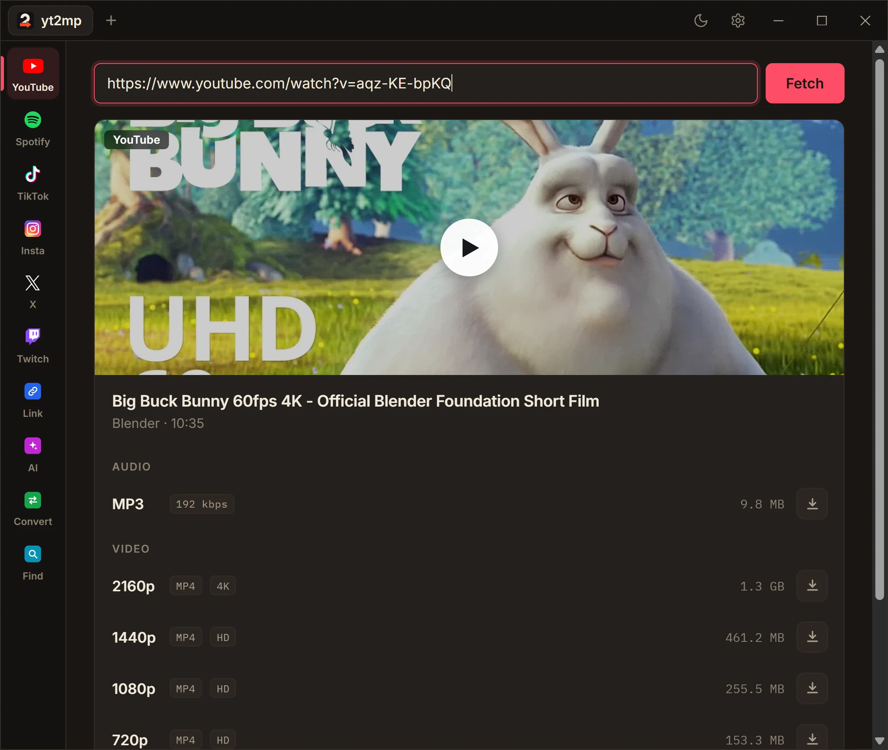
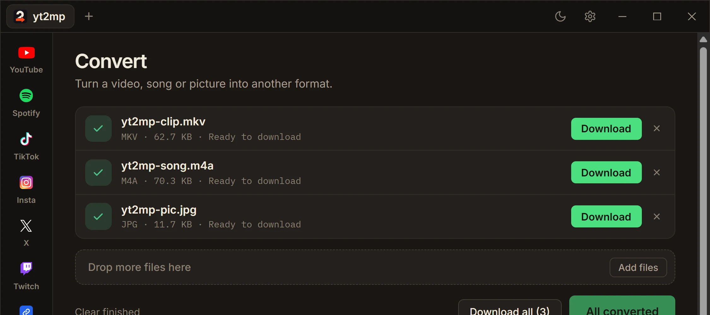

# yt2mp

Paste a link, keep the file. A free desktop app that downloads from **YouTube,
Spotify, TikTok, Instagram, X and Twitch**, converts to **34 formats**, and has a
browser built in. It runs on **your own computer**: no account, no shared server,
no ads, no upload limits.

<p align="center">
  
</p>

## What it does

- **Download.** Paste a video, a playlist, a Spotify song, album or playlist (matched
  on YouTube Music), a TikTok, a reel, a post or a Twitch VOD. Pick MP3 or a video
  quality and go.
- **Convert.** Drop any video, song or picture and turn it into one of 34 formats.
  Trim, resize, change the codec, mute, normalise the volume. Everything is done
  locally with the bundled ffmpeg.
- **Find on page.** Give it an article or a listing that is not a video itself and it
  digs out whatever is downloadable.
- **AI search.** Describe the song or video you are after and it finds it on YouTube.
- **Built-in browser.** Tabs inside the app, with a Download button that hands the
  page you are on straight to the downloader (Windows).
- **History.** Everything you downloaded, in its own tab, one click to fetch it again.

<p align="center">
  
</p>

This repo is split by platform:

- **`web/`**: a small Next.js landing page, deployed to Render. It only describes the
  project and links to the desktop app download. It does no downloading itself.
- **`app/`**: the Tauri desktop app that does the actual work. See
  [app/README.md](app/README.md) for how it is built, what is bundled, and how AI
  search is configured.
- **`apk/`**: reserved for the Android app; nothing here yet.

## Download

- **[Latest release](https://github.com/Albis0/yt2mp/releases/latest)**: grab the
  Windows installer (`yt2mp_x.y.z_x64-setup.exe`) and run it. The app updates itself
  from then on.
- Linux: `yt2mp_x.y.z_amd64.AppImage` from the same release.

## Privacy

There is no account, no analytics and no tracking, and nothing is sent to the
maintainers. The app talks to other services only when you ask it to, and only with
what the request needs:

- The link you paste goes to the site it belongs to, to fetch the file.
- **AI search** sends the words you typed, and the Spotify match check a song title,
  artist and length, to this project's server, which passes them to
  [Groq](https://groq.com) and keeps no copy. Nothing else, and nothing at all if you
  use neither. With your own Groq key (Settings → AI) the app talks to Groq directly
  and the server never sees it.
- The update check asks GitHub whether a newer version exists.
- If you let it borrow a browser session (Instagram and TikTok need one for most
  posts), the cookies stay on your computer and go only to the site they belong to.

Downloads, history and settings are stored on your computer and nowhere else.

The AI features come with a small daily allowance on the shared keys (5 searches and
5 Spotify checks per 24 hours). Past it, search uses your exact words and Spotify
matches without the AI check. Add your own free Groq key in **Settings → AI** and the
limit goes away.

## Code signing policy

The Windows installer is **not code-signed yet**. We are applying for free code
signing for open source projects from [SignPath Foundation](https://signpath.org/).
Once it is approved this section will say so, and every release will be signed with
the foundation's certificate after a manual approval.

- **Roles:** [Albis0](https://github.com/Albis0) is the author, reviewer and approver
  of every release.
- **Builds:** releases are built from this repository's public source by GitHub
  Actions ([`release.yml`](.github/workflows/release.yml)), and only from that source.
- **Updates inside the app** are already cryptographically signed, and the app refuses
  anything that is not.

Until then, Windows SmartScreen shows a warning the first time you run the installer.
That is a missing certificate, not a detected threat.

## ⚠️ Disclaimer — use at your own risk

This is free, open-source software provided **"as is", without any warranty** (see the
[license](#license)). By downloading, building, or using it you agree that:

- **You are solely responsible** for how you use this tool and for any content you
  download with it.
- Downloading content from YouTube may violate
  [YouTube's Terms of Service](https://www.youtube.com/t/terms). Only download content
  you have the right to (e.g. your own uploads, public-domain, Creative Commons, or
  material you're otherwise permitted to save). Respect copyright law in your country.
- The authors and contributors are **not liable** for any misuse, data loss, account
  action, legal consequence, or damage arising from the use of this software.

This project is intended for personal use — for example saving your own videos or
content you're allowed to keep offline. It is **not** intended to facilitate copyright
infringement.

## 🛡️ Virus scan

Every release installer is scanned before publishing. The installer bundles
[yt-dlp](https://github.com/yt-dlp/yt-dlp) and [ffmpeg](https://ffmpeg.org/), both
well-known open-source tools, but because it's an unsigned `.exe` that spawns those
binaries, some antivirus engines may flag it heuristically (a false positive common to
yt-dlp wrappers).

- **MetaDefender Cloud:** _pending re-scan for the current release_. Check the SHA256
  on the [latest release](https://github.com/Albis0/yt2mp/releases/latest) page against
  what you downloaded in the meantime.
- **VirusTotal:** _coming soon_

If your browser or Windows SmartScreen warns about the download, that's the unsigned-exe
warning. You can verify the file yourself with the scan links above.

## License

Licensed under the **[GNU General Public License v3.0 or later](LICENSE)**.

In short: you're free to use, study, modify, and redistribute this software, but any
distributed derivative must also be open source under the GPL. (Translation: someone can
fork it, but they can't legally take it closed-source and wrap it in ads.)

## Why an app and not a website

The download logic used to run server-side (Next.js API routes calling yt-dlp/ffmpeg),
deployed on Render's free tier. That ran into two problems that don't go away without
paying for a bigger instance:

1. **YouTube bot detection**: shared cloud IPs get blocked with "Sign in to confirm
   you're not a bot", requiring a PO-token server + cookie auth workaround.
2. **Memory limits**: the free instance OOM-killed under real download load even after
   trimming process memory.

Moving the actual download to a desktop app run by the user sidesteps both: the user's
own IP isn't flagged, and there's no shared memory budget to exceed.

## Local development

The landing page uses [Bun](https://bun.sh):

```bash
cd web
bun install
bun run dev
```

Visit `http://localhost:3000`. The desktop app has its own steps, in
[app/README.md](app/README.md#develop).

## Deployment

Render builds the landing page from the root `Dockerfile` (a minimal bun image that
copies `web/` and serves the static Next.js page on `$PORT`). Push to `main` and Render
redeploys automatically. On Render's free plan the service sleeps after 15 minutes
without a request, so [`keepalive.yml`](.github/workflows/keepalive.yml) asks for the
home page every 5 minutes to keep it awake.

The desktop app is built and published separately by
[`.github/workflows/release.yml`](.github/workflows/release.yml), which runs on a
version tag and attaches the Windows and Linux artifacts, plus the `latest.json` the
app's updater reads, to the GitHub release.

## Contributing

Bug reports and pull requests are welcome. Please read
[CONTRIBUTING.md](.github/CONTRIBUTING.md) first. It covers how to get the app
building locally, what to run before opening a PR, and which kinds of change
will not be accepted.

Participation is governed by the [Code of Conduct](.github/CODE_OF_CONDUCT.md).

Found a security problem? **Do not open a public issue**. See
[SECURITY.md](.github/SECURITY.md) for how to report it privately.
